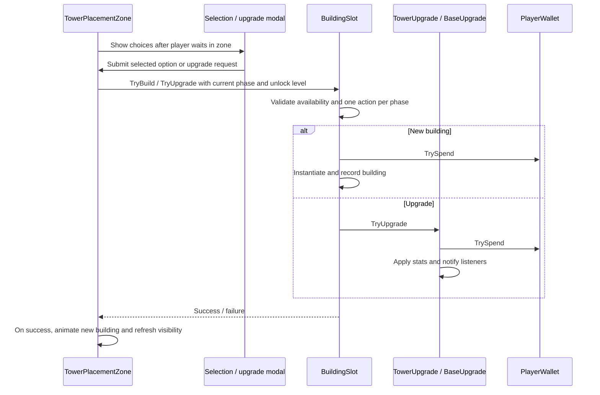

# Tower Defense architecture

This describes the incremental refactors for building transactions, session state
and health presentation. Enemy AI and entity death/respawn remain component-based.

## Asset ownership

`Assets/Tower-Defense` owns game code and content. Runtime components live in
`Scripts` by system; `Data/Enemies`, `Data/Loadouts` and `Levels` hold
authored configuration; `Prefabs` holds reusable scene objects. `Art` owns
visual source files: current and still-referenced legacy building models,
character models, environment assets, materials, shaders, animations and UI
images. `Settings` contains this game's render and build profiles. Imported
vendor packages stay in their original folders under `Assets` or `Packages`.
`Resources/PlayerShieldSphere.prefab` stays in `Resources` because
`PlayerShieldVisual` loads it by name at runtime.

## Start reading here

1. `GameSession`, then `WaveSpawner.Start`, `StartNextWave` and `RunCombat`: the session rules and build/combat loop.
2. `Damageable.TakeDamage` and `MobHealth.OnDeath`: damage and wave completion.
3. `MobCore.Update`: enemy targeting, navigation and attack coordination.
4. `BuildingSlot`: building ownership, purchases and upgrades.
5. `TowerPlacementZone`: player interaction and presentation around a slot.
6. `TowerUpgrade` / `BaseUpgrade`, then `BuildingLevelList` and `GameplayToolkitView`:
   upgrade numbers and their UI Toolkit presentation.

## Permanent player progression

`SkillTreeState` owns permanent money, purchased ranks, the selected weapon
module, prerequisites, and the highest cleared difficulty of each level.
`PlayerProgression` saves that state to PlayerPrefs and migrates old skill
points at 100 money per point; it never spends `PlayerWallet` coins. `LevelSetup`
resolves the selected difficulty and configures its waves. It grants the
permanent victory reward when `VictoryScreen` observes `AllCompleted`, or a
defeat reward when `WaveSpawner` enters `Defeated`: full reward multiplied by
completed waves divided by total waves, rounded down. A shared reward gate
allows only one outcome award per run; replaying a level can pay again.
The Victory Skills button requests the skill screen
in the next MainMenu scene. `MenuToolkitView` displays the skill tree and submits
purchases. `PlayerSkillBonus` on the Player prefab
applies the purchased health, shot-damage, and fire-rate bonuses once when the
level starts. New levels need a unique progression ID and three authored
difficulty configurations.

Difficulty variants can set enemy health, damage and movement-speed multipliers.
`WaveSpawner` applies them to each spawned or reused mob; the prefab remains the
source of base health, attack damage and movement speed. Level 1 uses 1.5x/2x
health and 1.08x/1.16x movement speed on Hard/Nightmare, while damage stays 1x.
`MobSlow` preserves the selected speed multiplier when a temporary slow expires.
The shared Level 1 scene
uses `LevelSetup.IsFirstLocation` to select first-location building rules.
`TowerPlacementZone` may hide a point there or use a location-specific loadout
without removing the point or its general options from later levels.

`MineIncome` tracks active surviving mines for income and the Bat target selector.
Bat chooses the nearest surviving mine, then the base; Destroyer uses the
base-only selector. Spider and Shooter still use nearest-threat selection.
`PulseTower` excludes the Flying tag, grows its overlap buffer when crowded,
and damages each target once per pulse even with multiple colliders.

`PauseMenu` owns run exit confirmation in active Build and Combat phases. It
pauses the clock before showing the UI Toolkit confirmation and restores time
on cancellation or scene transition. A foregrounded Android run remains paused
after the app returns from the background. Closing the app does not serialize
an unfinished run.

## Building flow

`BuildingSlot` is a plain C# object. It owns the built-object references and
`UsedThisPhase`. `BeginBuildPhase` clears the action limit without removing the
building. Purchases reject the wrong slot type, options outside the loadout,
negative costs, missing wallets, insufficient coins, locked slots and combat.
The phase and unlock checks run at submission time, including upgrades.

`TowerPlacementZone` keeps the existing serialized Inspector fields, so current
prefabs and scenes need no field migration. It handles player proximity, progress
indicators, modal interactions and spawn animation. Its public building properties
delegate to its slot. Leaving the zone, losing interaction eligibility, combat
and disabling the zone close its owned panel. Shared panels record their owning
zone; overlapping zones cannot steal or close another zone's interaction.
Build and upgrade submissions recheck physical proximity before spending coins.
An optional `requiredBuiltZone` reference keeps a point hidden until its source
point has been built. The prerequisite is checked again when a purchase is submitted.
Level 1 uses it to reveal the second mine after the first mine and Pulse points
in a chain after the starting cannon, alongside their town-hall level requirements.
The panel roots have no active full-screen backdrop or pointer blocker, and no
Close buttons. The joystick remains available while a panel is open.

`LevelGrid` and its custom Inspector are editor-only level-authoring helpers:
the selected scene grid draws cell and building-footprint previews. Placement
first fixes the future building footprint, then restricts the interaction marker
to adjacent free cells. The connected `TowerBuildZone` prefab keeps its spawn
point at the building center and its marker at the selected side. Existing
building footprints and markers block occupied cells. Runtime purchase
and interaction rules remain in `TowerPlacementZone` and `BuildingSlot`.
Grid-created zones carry `LevelGridPlacedZone` authoring metadata so clicking
their footprint or marker selects the pair. A line shows their relationship,
and the LevelGrid Inspector can move either the building with its marker or
just the marker, or delete the pair. Placement checks ignore the selected
zone's old cells during a move, while all other occupied cells still block it.
Unity Undo handles creation, movement, deletion and type changes; at runtime
the wall uses only the saved footprint to determine its length and price.
Each grid is independent; the Scene view painter checks zones across the scene
for occupied cells. A temporary purple model follows the pointer. Each
grid-created zone stores an automatically chosen representative preview prefab
for its building type; the selected grid draws
cyan editor-only ghosts for its placed zones and red/orange occupancy marks for
all building footprints and interaction cells. Preview objects have no active
behaviors or colliders and are destroyed when the grid is deselected. Existing
zones without a saved model use the first matching option in their loadout.
The grid's Wall tool takes a first and last cell to reserve a one-cell-wide
horizontal or vertical span. Only interaction cells along the long sides are
offered, so `LevelGrid.GetBuildingRotation` keeps the wall model aligned with
its occupied cells. `LevelGridPlacedZone.BuildingCells` retains each wall's
individual length; the selected zone can be resized without changing the grid's
other buildings. `WallSpan` repeats the model once per reserved cell at the
cell pitch, reveals sections from left to right, and sizes one shared collider and carved NavMesh
obstacle to the full span. `BuildingSlot` multiplies the Wall option's
cost by its reserved cell count, and `TowerSelectionModal` shows that same amount
before purchase. Wall locations remain authored through the
grid rather than being created automatically on every available cell.
`LevelGridTileSurface` is an optional visual floor for the same grid: it builds
one mesh with a separate 0–1 UV island per cell and can use one shared collider.
The existing Level 1 terrain stays in place unless the surface is explicitly
enabled and given a material.

`TowerSelectionModal` owns both construction and upgrades as data for the
UI Toolkit build panel. Zones supply their validated purchase
operation and the original `BuildingSlot.BuiltOption`, so the same name, icon and
authored progression remain available after construction. The separate
`TowerUpgradeModal` controller and prefab have been removed. A card from an older
opening cannot submit a transaction after the panel is closed or repopulated.

`BuildingLevelList` reads prefab stats and every authored upgrade without spawning
objects. The UI Toolkit build panel shows a building's role and price, or current
and next-level health, damage and mine income for an upgrade.
`MortarTower` uses `DetectionZone` to choose a target position, while
`MortarShell` owns the arc and one-hit-per-enemy splash at that position.
`WallCollision` keeps the wall's collider and carved NavMesh obstacle active only
while its `TowerHealth` is alive. `BuildingSlot` sorts available choices by cost,
preserving loadout order for equal prices.
`BuildingSlot.CanInteract` hides built-building points unless a next upgrade is
unlocked; Town Hall points need only a remaining level. Town Hall changes refresh
zone visibility immediately. Insufficient funds disable purchasing in the panel.
`TowerPlacementZone` creates a floor-facing sprite from its authored zone icon
and a world-space progress ring at runtime. The ring appears while R-07 is in
the zone, fills before opening the UI Toolkit build panel, stays full while the
choice is open, and disappears immediately on exit. The zone controller stays
active when a LevelGrid point uses its own GameObject as `visualRoot`, allowing
town-hall and prerequisite unlocks to reveal it later.

## Allied squads

`TowerLoadout` offers the melee barracks card at town hall level 2 and the ranged
card at level 3. The ranged card builds `BarracksRanged`, a variant of the melee Barracks
prefab with `squadType` set to Ranged. Each barracks trains its entire `squadSize`
from its selected ally prefab; the squad type stays fixed after construction.
When an ally dies, its slot respawns with the same selected type. Both types
obey the existing formation, attack and follow commands. A ranged `AllySoldier`
requires an assigned `Projectile` prefab and fire point; its shot deals damage
only on projectile impact. The `Ally Ranged` prefab is a variant of `Ally Soldier`.
`SquadOrderController` handles touch/mouse orders directly in both gameplay
scenes: tap the flag icon above a built barracks, then tap the assigned terrain
collider in the temporary map view during preparation or combat. The map view
hides gameplay canvases, leaves a separate Cancel button, and pulls the camera
back from the player without changing its angle. It restores the Cinemachine
player camera after an order or cancellation. Each
`BarracksBuilding` validates the NavMesh destination, returns the route corners
for brief line feedback, and owns one independent
guard point for its squad. Soldiers hold their assigned formation and acquire
enemies near that point during combat; replacements inherit the order. The
Rally button temporarily switches all squads to following the hero and restores
their own guard/default modes when switched off. A lightweight world ring shows
the selected barracks and each assigned guard point.

## Timed slowing bonus

`EnemyLoadout.asset` holds one entry per enemy option with slow-ammo, shield and
companion drop chances and durations. The chances are mutually exclusive and
sum to at most 100%; the remaining probability means no pickup. It also holds
the shared pickup prefabs. The Spider entry
currently drops a 12-second slowing bonus at 25% chance. `WaveSpawner` validates the
table when the level is configured, then configures a
`MobLootDrop` on each spawned or pooled enemy. The drop subscribes to
`MobHealth.OnDeathHandled` and creates a standalone pickup before the enemy
returns to its pool. `SlowAmmoPickup` grants bonus time on player contact.

`SlowAmmoInventory` owns the player's remaining bonus time (capped at 24 seconds).
While it is active, every normal projectile from the player's `Shooter`
can apply `MobSlow` only
after hitting a surviving mob. `MobSlow` changes NavMeshAgent speed or the
`FlyingNav` speed multiplier, restores speed when time expires, and clears on
pool disable. `GameplayToolkitView` shows a snowflake and remaining seconds
on the left side of the HUD while the bonus is active.

The same enemy entry has shield drop settings.
Destroyer currently has a 25% chance to drop a 12-second shield pickup. The
pickup grants 50 shield points, refills them on a second collection, and adds
remaining time up to 24 seconds. The Level 1 scene contains the effect icons in an
`effectRow` in `Gameplay.uxml`. `GameplayToolkitView` updates timers and hides
inactive chips, so the layout has no gaps.

The Shooter entry currently has a 20% chance to drop an 18-second companion
capsule. `CompanionTurretController` on the Player prefab owns two slots. A pickup
fills an empty slot or refreshes the turret with less time remaining. Each
`CompanionTurret` follows its slot beside the player and reuses `DetectionZone`,
`Shooter` and `Projectile` for autonomous fire. Turrets expire independently and
are removed on player death. `PickupHighlight` animates lightweight glimmers on
the slow-ammo, shield and companion pickups so they remain visible against the
arena. `GameplayToolkitView` reads the companion controller and shows its active
count and longest remaining duration beside the slow-ammo and shield statuses.

`LevelSetup` ignores physical collisions between Player and Enemy layers while
the level is loaded, so the player cannot stand on mobs. `PlayerHealth` restores
only collisions it temporarily changed during ghost state.

`PlayerHealth` starts without a shield. A pickup calls `GrantShield`, after which
damage consumes shield before reaching HP. The shield disappears when depleted,
on expiry, or on death; respawn does not restore it. `PlayerShieldVisual` toggles
a non-colliding, transparent URP sphere while shield remains.
The player placed directly in `Level` creates this visual from
`Resources/PlayerShieldSphere` at runtime; `Player.prefab` has it assigned.
`HealthBarManager` projects HP and player shield bars into UI Toolkit and updates
their position from scene anchors. It owns binding lifetimes and creates no Canvas.

`FirstLevelTutorial` stores which first-level hints have appeared. `GameplayToolkitView`
supplies the current build offer, phase and combat context. The settings screen queues
a replay in local preferences and the next first-level entry consumes it. The main menu
builds the guide from `TowerLoadout` and tracks discovery of the Pulse tower independently
of run state.

Enemy combat behaviors report attacks on the core through `MobCore`. The core
keeps attackers registered between strikes and releases them when they leave
attack range, change target, die, or return to the pool. `GameplayToolkitView`
uses this state for the warning, plays the wave-start clip on the combat phase
event, and highlights the ultimate when it becomes ready again.

`ResponsiveGameplayHud` selects Mobile or Desktop UI Toolkit controls from the
build target. Editor `Automatic` previews the active build target; the Inspector
override can switch layouts during Play Mode. `PlayerMovement` accepts WASD/arrow input and
movement from the UI Toolkit joystick. `PlayerUltimate` owns the input mode: by default, one press
charges to the configured fraction and fires automatically; `Manual Charge`
restores press-and-release control. `GameplayToolkitView` routes touch and desktop
Space input to that rule and places the enemy spawn previews on screen.

## Upgrade data and display

`TowerUpgrade.GetCurrentStats` reads current component values. `GetNextStats`
returns the next level calculated from cached original values, not the previous
upgrade's results. The same calculation supplies tower upgrade application.

`BaseUpgrade` exposes current and next health through the same `BuildingStats`
value type. Missing stats are nullable: a mine has income and HP, but no attack
stats. A maxed building returns no next snapshot.

`UpgradeStatsFormatter` owns labels, ordering, number formatting and lock messages.
Both upgrade modals use it. Gameplay components no longer produce UI strings.
Existing multipliers, costs, HP top-ups and the displayed base-level numbering
are preserved.

## Checks

Use **Window > General > Test Runner** to run `TowerDefense.EditMode.Tests` and
`TowerDefense.PlayMode.Tests`. See the README for commands and coverage limits.

With Unity outside Play mode, **Tools > Tower Defense > Run Architecture Checks**
also runs the original regression sweep. It uses a temporary preview scene and
closes it afterward without saving.
They test cannon/pulse/mine/base calculations and display text, base-level unlocks,
HP recovery, purchase rejection, placement and one-action-per-phase behavior.
They are edit-mode checks, not a full playthrough or UI pointer simulation.

Required shooter and enemy-module references are now validated explicitly. Enemy
prefabs supply all three module references. Missing projectiles cannot turn into
instant damage, and missing wallets cannot make upgrade menus assume unlimited money.

## Attack range

`DetectionZone` defines a horizontal targeting radius and a separate maximum
height difference. A physics box query collects colliders; aim-point checks narrow
them to a cylinder and deduplicate damageable entities. This keeps aerial coverage
consistent with the ground range indicator. `GetClosest` uses horizontal distance
and drops dead/out-of-range cached targets. `Shooter` still checks line of sight
and delivers damage through projectiles. Tower range upgrades change the radius;
vertical reach is configured separately. See `Docs/Balance.md` for tuning targets.

## Session ownership

### Authored levels

LevelDefinition is a ScriptableObject containing presentation metadata, starting
coins and waves. It is the only authored source of the initial wallet balance;
PlayerWallet requires LevelSetup to pass that balance before its Awake. The
dedicated wave/group/entry types expose only the supported
authoring fields, without the spawner's legacy prefab or icon alternatives.
Validation rejects missing enemies, invalid counts/timings/rewards and invalid
spawn-point indices. CreateWaves copies data into fresh runtime arrays.

`MenuToolkitView` creates page selectors from `MainMenu`'s Levels list and previews
the chosen encounter. Start stores the asset and target scene in RunSelection, then loads
the shared Level 1 scene. LevelSetup executes before the wallet's Awake and the
spawner's Start: it resolves the selection, validates scene spawn references,
configures waves and sets starting coins. Direct scene entry uses its explicitly
assigned Direct Play Level. Missing configuration stops setup with an error.
Restart retains the selection but creates fresh runtime waves and coins.
`MainMenu` keeps selection and launch eligibility; `MenuToolkitView` owns the
interactive controls and visual selection state.

Unity Localization's `Game UI` collection holds the Russian and English UI
strings in `Assets/Tower-Defense/Localization`. The language controls in
`MenuToolkitView` set the active locale. Startup selects the saved preference,
then a supported device language, then English. `GameLocalization` loads the
active string table, updates Toolkit text and tooltips tagged in UXML, and
formats dynamic labels such as the wave counter and construction cost.

Main Menu and Play Mode subsystem initialization clear the static selection.

`GameplayLab.unity` is a separate Editor playtest scene copied from the shared
Level 1 setup. It retains the player, HUD, 21 authored build zones and four
spawn references, while its environment is one neutral plane with a separate
baked NavMesh. `GameplayLab.asset` supplies four authored waves through the
same `LevelSetup` and `WaveSpawner` path as the campaign. Its distinct
progression ID and zero victory money keep lab outcomes separate from campaign
levels. The Main Menu's Home screen has a separate TEST LEVEL action wired to
`MainMenu.StartGameplayLab`, which selects the lab definition and loads the lab
scene. GameplayLab is the third enabled build scene so game UI navigation and
Restart work in Player builds; it is not included in campaign level selection.
The neutral floor spans 120×120 m, with `Traversal Probe` markers 90 m apart
for movement checks. Build zones and enemy spawns stay in the central combat
area. The lab's existing NavMesh asset was rebaked without changing its GUID;
the campaign scene and its navigation asset are separate.

The seeded-wave prototype and inline scene waves have been removed. WaveSpawner
holds only a runtime copy of the selected level's waves. Missing level setup
stops the spawner with a configuration error instead of creating an empty session.
During Build, `GameplayToolkitView` asks the spawner for the next wave's preview.
The spawner combines counts by spawn transform and enemy prefab. The view projects
the actual spawn position onto its panel. Visible points show an
icon and count for each enemy type; off-screen points collapse to one circular
badge with the total count and an arrow toward the spawn. The preview is
cleared at the start of Combat.
LevelDefinitionTests covers asset validity, runtime-copy isolation, restart,
scene isolation and rejected configuration. LevelSetupTests checks actual
Awake/Start ordering, initial coins and wave configuration across recreated
sessions, and rejection of nonexistent spawn points. UIConfigurationTests
protects serialized menu/modal references and persistent actions.

### Session state

`GameSession` is ordinary C# with no Unity dependencies. It receives wave rewards
and an explicit reward operation. It owns the phase and next-wave index, rejects
duplicate or out-of-order completion, and treats victory and defeat as terminal.
Completion commits its state before notifying the wallet, preventing a wallet
listener from awarding the same wave again.

`WaveSpawner` adapts those rules to Unity coroutines and existing phase events.
It observes base creation/removal because the town hall is built during play;
subscriptions are detached from the exact base instance on replacement/disable.
Base death defeats the session and cancels spawning/completion coroutines.
The wallet, victory screen and game-over screen use assigned references.
Screens display outcomes; they no longer determine them.

## Health presentation lifetime

`Damageable` has no health-bar references or registration calls. `HealthBarBinding`
owns the health target, optional position anchor and death visibility.
Active bindings register in a UI-only registry. `HealthBarManager` accepts only
bindings from its scene and projects their HP and shield into a non-interactive
UI Toolkit layer supplied by `GameplayToolkitView`. Both creation orders work;
disabling either side releases its entries. Bars at full health or on dead
entities hide according to binding and manager settings. Scene unloading removes
the layer and registry entries. Regression tests cover binding order, repeated
enable/disable, replacement and scene unloading; full-level visual checks remain
separate.

`MenuToolkitView` and `GameplayToolkitView` own the presentation layer. Their
UXML, USS and shared PanelSettings live under `Assets/Tower-Defense/UI/Toolkit`;
the C# views live in `Scripts/UI`. MainMenu, Level 1 and GameplayLab contain no
Canvas. The views read state from menu, wave, wallet, progression, audio, pause,
build selection and squad order components, then send actions back through them.
The mobile joystick writes a normalized vector into `PlayerMovement`; desktop
keyboard movement uses its existing path. `TowerSelectionModal` exposes build
offers without instantiating uGUI cards. `GameplayToolkitView` renders those
offers, zone progress, spawn previews and combat overlays. `HealthBarManager`
projects entity health into the same panel.

## Next boundaries to improve

- Make tower combat shutdown explicit instead of disabling every neighboring script.
- Define ownership of ally death cleanup and replacement.
- Replace singleton lookups selectively with explicit dependencies when touching
  those systems; a new dependency-injection framework is unnecessary.

Player weapon presentation: `PlayerGunAim` applies vertical pitch to both robot
gun bones after animation, while `PlayerMovement` owns horizontal turning.
The Player prefab assigns both bones explicitly; muzzle markers are children of
their respective guns. Elevation/depression limits and turn speed are tunable on
`PlayerGunAim`. Target loss returns the guns to the animated pose.
`SkillTreeState` also stores the purchased and equipped player gun module in the
existing progression save. `MenuToolkitView` owns the Equipment screen and
purchase/equip actions. `PlayerSkillBonus` combines skill and module multipliers
once on level start; the module changes rate/damage without replacing the gun
prefab. Old progression saves default to Standard.
The Equipment screen also offers independent left/right weapon and armor
appearance previews. These switch concept images only; they do not alter the
saved loadout or player combat until corresponding equipment items exist.
`GameplayToolkitView` shows node damage with a brief red edge alert and reads
the node's current health directly from `Base`.

## Menu screens and audio preferences

`GamePerformanceSettings` initializes frame pacing before scene load and owns the
saved FPS visibility preference. The UI Toolkit views expose that preference in
their settings panels and display FPS using unscaled frame time, including during
pause. Frame-rate policy and the UI Toolkit FPS readout are covered by
`FrameRatePolicyTests` and the gameplay view checks.

MainMenuScreens owns home, level selection and settings visibility. MainMenu owns
the selected level and explicitly colors the active page independently of keyboard
focus or button disabled state.

GameAudioSettings loads Music/Effects preferences before scenes start. Effects use
AudioListener.volume; BackgroundMusic sets ignoreListenerVolume and multiplies its
authored volume by the music preference. Other sound sources must keep
ignoreListenerVolume disabled. This covers spawned and pooled effects without a
scene scan. UI changes are persisted on leaving settings and disabling the menu.

PauseMenu keeps gameplay paused while its UI Toolkit audio panel is open.
`GameplayToolkitView` binds the same GameAudioSettings preferences as the home menu.
Outcome screens offer Main Menu; VictoryScreen additionally offers Next Level only
after a completed session with an assigned LevelDefinition.nextLevel. LevelSetup
exposes the resolved CurrentLevel, including direct Editor entry. Next Level selects
the next asset and reloads the shared scene; the last level has no successor.
The authored chain is Level1 -> Level2 -> Level3. Main-menu transitions clear the
selection and restore time scale. Defeat exposes only Main Menu.
PlayerGunAim now also pitches the explicitly assigned head bone, restoring its
animated pose before each frame and on disable, just like both weapon bones.

`PlayerUltimate` adds a five-second delay to its three-to-five-second charge
cooldown, for eight to ten seconds total. `GameplayToolkitView` shows the remaining
seconds and charge progress. Both
normal bullet prefabs fly faster; `Projectile` checks the movement
segment each frame so it cannot step across a target without hitting it.
