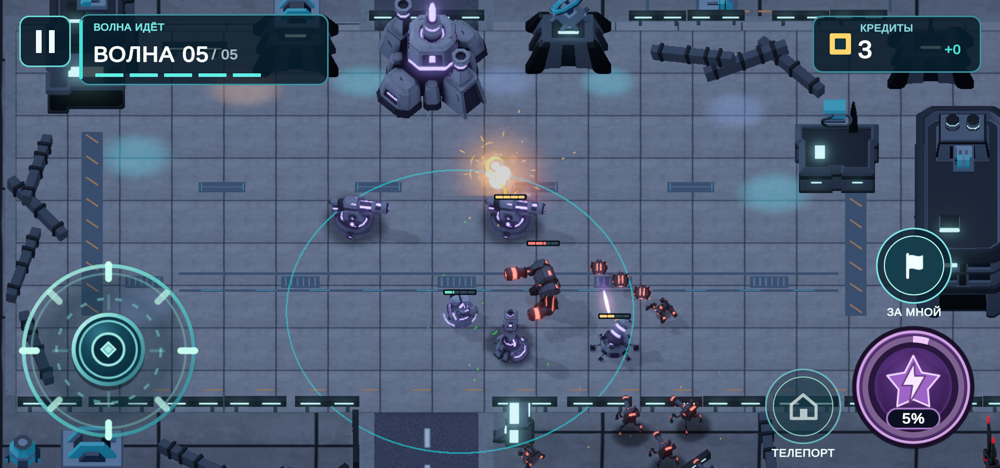
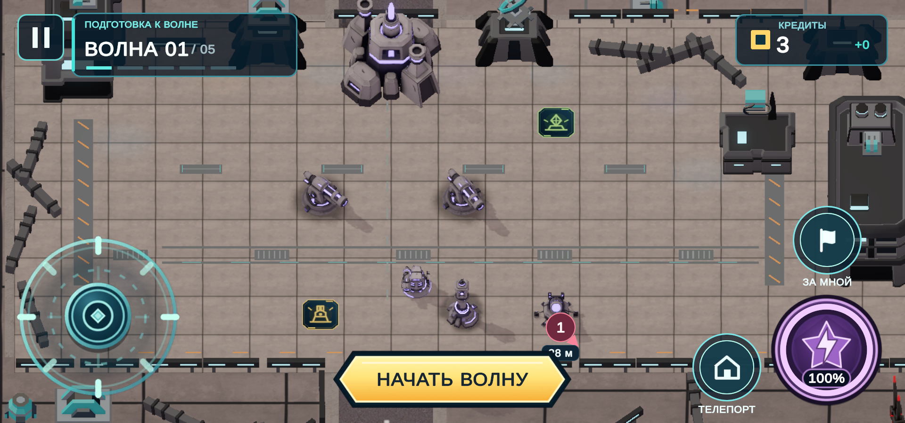

# Рубеж К-7

«Рубеж К-7» — одиночная 3D-игра про оборону научно-фантастической базы.
Между волнами вы строите и улучшаете оборону, а во время атаки сами выходите
на поле за робота Р-07 «Искра». Цель — сохранить центральный узел и пережить
последнюю волну.

Проект в разработке на Unity. Целевые платформы демоверсии — Android, Windows и macOS.
В настройках можно выбрать русский или английский язык.

*Первая карта во время ночной волны.*

## Быстрый запуск

1. Установите **Unity 6.0.72f1 (6000.0.72f1)** через Unity Hub.
   Точная версия записана в [ProjectVersion.txt](ProjectSettings/ProjectVersion.txt).
2. Добавьте корневую папку репозитория в Unity Hub и откройте её.
   Дождитесь импорта ассетов и компиляции.
3. Откройте [MainMenu.unity](Assets/Tower-Defense/Scenes/MainMenu.unity),
   нажмите **Play** в редакторе и выберите уровень в меню игры.

Для быстрой проверки боя откройте [GameplayLab.unity](Assets/Tower-Defense/Scenes/GameplayLab.unity)
или выберите тестовый уровень в главном меню. Это отдельная площадка с четырьмя
волнами и своим набором настроек. Для работы над кампанией можно открыть
[Level 1.unity](Assets/Tower-Defense/Scenes/Level%201.unity) напрямую.

## Как играть

1. **Подготовьтесь.** Встаньте в зону строительства и дождитесь, пока заполнится
   индикатор. Потратьте кредиты на башню, шахту или улучшение. Чтобы закрыть окно
   строительства, выйдите из зоны.
2. **Запустите волну.** Башни и Р-07 стреляют автоматически. Перемещайтесь
   между участками обороны и используйте заряженную атаку против скоплений врагов.
3. **Усильте оборону.** За пройденную волну начисляются кредиты. Улучшение
   центрального узла открывает новые постройки, в том числе казармы.
   Бойцам можно назначить отдельную точку обороны.
4. **Удержите узел.** Если узел уничтожен, забег заканчивается поражением.
   За победу начисляется отдельная валюта для навыков и оснащения между забегами.

*Та же карта в фазе подготовки.*

| Действие | ПК | Сенсорный экран |
| --- | --- | --- |
| Движение | WASD или стрелки | Джойстик появляется при касании слева внизу |
| Начать волну | E | Кнопка «Начать волну» |
| Заряженная атака | Пробел | Кнопка со звездой |
| Телепорт к узлу | T | Кнопка телепорта |
| Позвать отряды за собой | F | Кнопка «За мной» |
| Выбрать постройку или улучшение | 1–9 в открытой панели или щелчок мышью | Касание карточки |
| Назначить точку обороны | B, затем стрелки и Enter | Флажок казармы, затем касание точки на карте |
| Пауза | Esc | Кнопка паузы |

Телепорт доступен во время подготовки. Кнопки отрядов появляются там, где
доступна соответствующая механика.

## Что есть в проекте

- **Кампания.** В меню три набора волн и три сложности. В текущем прототипе
  наборы используют одну игровую сцену. План первого демо описан в [GDD](Docs/GDD.md).
- **Настройки графики.** Можно менять освещение, карты нормалей и SSAO.
  На Android доступны профили качества и отдельный масштаб 3D, на ПК — режим окна.
- **Тест производительности.** В настройках графики есть базовый прогон
  с разным числом моделей и боевой прогон с 0, 6 или 12 башнями.
  В отчёте выводятся FPS, время кадра и вызовы отрисовки.

## Где искать код и настройки

Игровые файлы находятся в [Assets/Tower-Defense](Assets/Tower-Defense).

| Папка | Что в ней |
| --- | --- |
| [Scenes](Assets/Tower-Defense/Scenes) | Главное меню, сцена кампании и тестовый уровень |
| [Levels](Assets/Tower-Defense/Levels) и [Data](Assets/Tower-Defense/Data) | Волны, стартовые кредиты, враги, постройки и их параметры |
| [Scripts](Assets/Tower-Defense/Scripts) | Логика забега, бой, строительство, управление и сохранения |
| [Prefabs](Assets/Tower-Defense/Prefabs) | Игрок, враги, башни, снаряды и другие игровые объекты |
| [UI/Toolkit](Assets/Tower-Defense/UI/Toolkit) | Разметка и стили меню и игрового интерфейса |
| [Tests](Assets/Tower-Defense/Tests) | Edit Mode и Play Mode тесты |

Если меняете состав волн или баланс, начните с ассетов в **Levels** и **Data**.
Точки появления задаются в массиве **Spawn Points** у **WaveSpawner** на сцене.
Для размещения построек используйте инструмент **Place building zones** у
**LevelGrid**. Устройство этих систем описано в [карте архитектуры](Docs/Architecture.md).

Игра написана на C#. Для рендера используется URP, для интерфейса — UI Toolkit,
для управления — Input System, для маршрутов наземных агентов — AI Navigation.
Подробности об инструментах и версиях есть в [стеке разработки](Docs/Development-Stack.md).

## Сборка

Откройте **File → Build Profiles** и выберите платформу. Установите поддержку
этой платформы через Unity Hub, если её ещё нет. Сцены в сборке идут в порядке
**MainMenu → Level 1 → GameplayLab**. Техническое имя приложения в настройках
сборки сейчас указано как **Tower Defense**.

## Тесты

Откройте **Window → General → Test Runner** в Unity.

- **Edit Mode** — запустите `TowerDefense.EditMode.Tests` для правил и конфигурации.
- **Play Mode** — запустите `TowerDefense.PlayMode.Tests` для поведения объектов, боя и интерфейса.

Запуск из терминала Windows

Закройте редактор этого проекта. Выполните команды из корня репозитория.
При необходимости замените путь к установленному Unity.

~~~powershell
$unityEditor = 'C:\Program Files\Unity\Hub\Editor\6000.0.72f1\Editor\Unity.exe'
$projectPath = (Get-Location).Path
New-Item -ItemType Directory -Force TestResults | Out-Null

foreach ($mode in 'EditMode', 'PlayMode') {
    & $unityEditor -batchmode -projectPath $projectPath -runTests -testPlatform $mode `
        -assemblyNames "TowerDefense.$mode.Tests" `
        -testResults "$projectPath/TestResults/$mode.xml" `
        -logFile "$projectPath/TestResults/$mode.log" | Out-Host
    if ($LASTEXITCODE -ne 0) {
        throw "Тесты $mode завершились с ошибкой. См. TestResults/$mode.log"
    }
}
~~~

## Документация и лицензии

- [GDD](Docs/GDD.md) и [план реализации](Docs/GDD-Implementation-Plan.md) — дизайн игры и объём демо.
- [Баланс](Docs/Balance.md) — экономика забега, состав волн и результаты замеров.
- [Визуальное направление](Docs/VisualDirection.md) — интерфейс, оформление и визуальные проверки.
- [Правила проекта](AGENTS.md) — соглашения для работы с кодом и ассетами.
- [Лицензия MIT](LICENSE) — условия для кода проекта. Сторонние ассеты перечислены в [списке источников](Docs/ThirdPartyAssets.md).
